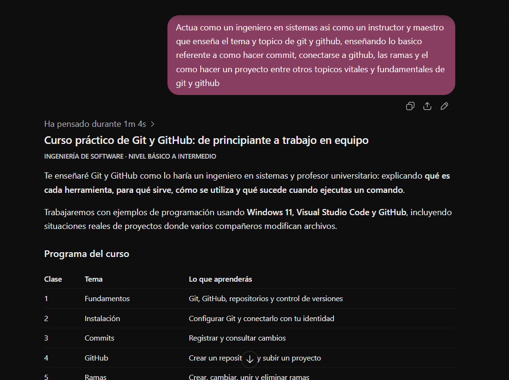
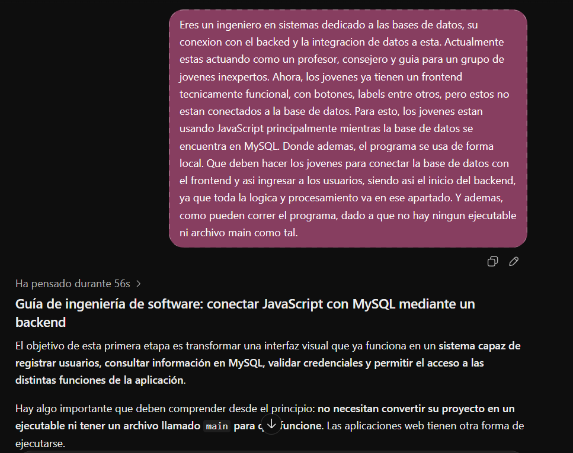
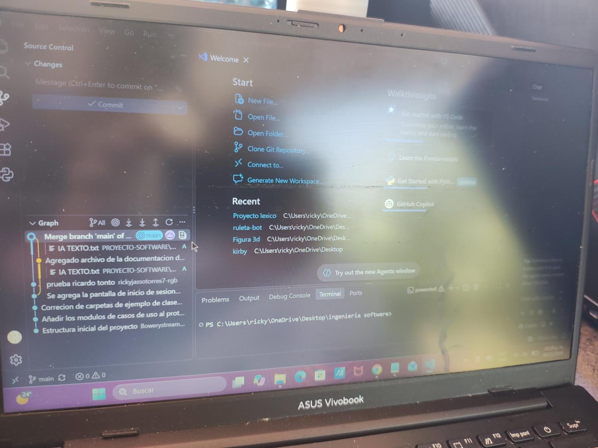
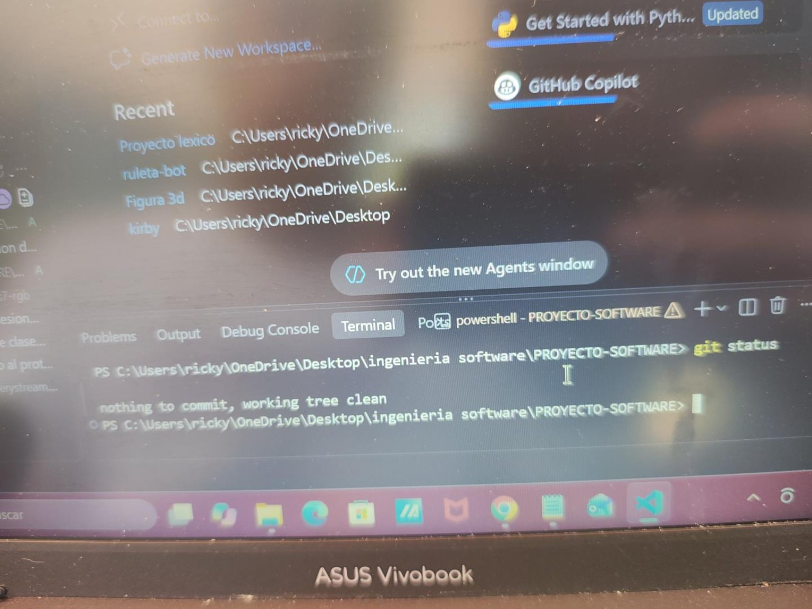

"Aprendizaje y uso basico de Git y Github"
Modelo: ChatGPT Sol (Alto)

Prompt: Actua como un ingeniero en sistemas asi como un instructor y maestro que enseña el tema y topico de git y github, enseñando lo basico referente a como hacer commit, conectarse a github, las ramas y el como hacer un proyecto entre otros topicos vitales y fundamentales de git y github

Resultado: # **Curso práctico de Git y GitHub: de principiante a trabajo en equipo**

INGENIERÍA DE SOFTWARE · NIVEL BÁSICO A INTERMEDIO

Te enseñaré Git y GitHub como lo haría un ingeniero en sistemas y profesor universitario: explicando **qué es cada herramienta, para qué sirve, cómo se utiliza y qué sucede cuando ejecutas un comando**.

Trabajaremos con ejemplos de programación usando **Windows 11, Visual Studio Code y GitHub**, incluyendo situaciones reales de proyectos donde varios compañeros modifican archivos.

## **Programa del curso**

| Clase | Tema             | Lo que aprenderás                                 |
| ----- | ---------------- | ------------------------------------------------- |
| 1     | Fundamentos      | Git, GitHub, repositorios y control de versiones  |
| 2     | Instalación      | Configurar Git y conectarlo con tu identidad      |
| 3     | Commits          | Registrar y consultar cambios                     |
| 4     | GitHub           | Crear un repositorio y subir un proyecto          |
| 5     | Ramas            | Crear, cambiar, unir y eliminar ramas             |
| 6     | Colaboración     | Clone, pull, push y pull requests                 |
| 7     | Conflictos       | Resolver cambios incompatibles                    |
| 8     | Proyecto real    | Administrar código entre varios programadores     |
| 9     | Buenas prácticas | Seguridad, recuperación, historial y organización |

## **Clase 1. ¿Qué son Git y GitHub?**

Aunque suelen mencionarse juntos, son herramientas diferentes.

**GIT**

Sistema de control de versiones instalado en tu computadora.

Permite guardar versiones de tu código, recuperar cambios y trabajar con ramas, incluso sin internet.

**GITHUB**

Plataforma en internet que aloja repositorios Git.

Permite compartir proyectos, colaborar, revisar modificaciones y organizar el trabajo.

### **Ejemplo sencillo**

Imagina que estás desarrollando un sistema de inventarios.

El lunes creas el inicio de sesión. El martes agregas el inventario. El miércoles modificas el código y accidentalmente provocas un error.

Sin Git, podrías terminar creando carpetas como:

```
proyecto-final
proyecto-final-2
proyecto-final-ahora-si
proyecto-final-definitivo
```

Con Git conservas un historial organizado:

**Commit 1 — Proyecto inicial**

Primera versión funcional

**Commit 2 — Inicio de sesión**

Se agrega la autenticación

**Commit 3 — Inventario**

Se registran entradas y salidas

**Commit 4 — Corrección de errores**

Se corrige el cálculo del inventario

Cada commit permite identificar qué modificaciones se realizaron y comparar versiones anteriores del proyecto.

### **Vocabulario fundamental**

| Término      | Significado                                     |
| ------------ | ----------------------------------------------- |
| Repository   | Carpeta de proyecto administrada por Git        |
| Commit       | Registro de cambios guardado en el historial    |
| Branch       | Rama independiente de desarrollo                |
| `main`       | Nombre habitual de la rama principal            |
| `origin`     | Nombre convencional del repositorio remoto      |
| Push         | Enviar commits locales a GitHub                 |
| Pull         | Traer e integrar cambios del repositorio remoto |
| Clone        | Descargar una copia de un repositorio           |
| Merge        | Integrar los cambios de diferentes ramas        |
| Pull Request | Solicitud de revisión e integración de cambios  |

## **Clase 2. Instalar y configurar Git**

Para trabajar de forma profesional necesitaremos tres herramientas: Git, una cuenta de GitHub y Visual Studio Code.

[Icona Logo Git di Those Icons – scarica in PNG, SVG](https://images.openai.com/static-rsc-4/JvChqviamcg8gCGCWQhdU6IRmtuGLk87XfT7sWbLkywJO09QIS6dMZqOizsZt9CJxx0TnSNYRP3K4UY2DnX4ljIx4T3GSCuO4Uld3EJMDR6Q6iEHOp7sDx-qsLF7Uaxdju_jWOJEYHLrQzYc64fXZFHQmITd4spebp4mzVF4Dfk?purpose=inline)

**1. Instalar Git**

Descárgalo desde [Git para Windows](https://git-scm.com/downloads/win?utm_source=chatgpt.com). Para comenzar, puedes dejar las opciones recomendadas del instalador.

[GitHub Vs. Bitbucket: Which Code Hosting Platform is Best? - Hatica](https://images.openai.com/static-rsc-4/h6nY0yf7JsEycY0Sx4mRb8nNKCcIcOBcXiDBB5zoyQB53kJfJ3b9fumZfym32-9QtI9bMIOfte8A4pxGn5j31kvTkB5L6rFXiUBQgJque7-Zjv7CR_c2oXmVt6Bh1m44flmqva6djfbFywIxlr_rYABjp8Znp5gQnvWf0wXwtYs?purpose=inline)

**2. Crear una cuenta de GitHub**

Ingresa a [GitHub](https://github.com?utm_source=chatgpt.com) y crea una cuenta gratuita si todavía no tienes una.

[File:Visual Studio Code 1.35 icon.svg - Wikimedia Commons](https://images.openai.com/static-rsc-4/bwltRsn8xFpdSRcYQ3DdHauINNG_Ll8uEuWak3gU_Cd8IQKU8JMwJXvDy7WOSMXzw_LreGtysSFaVMfFopIshhFxhhA7optqpzdDNA41Fr3DZ8RT6oELKwe8M8zFoIi4_H68G4UOg124XH5x4eObz-mHD-E9xY_6m_hLlZ275hc?purpose=inline)

**3. Instalar Visual Studio Code**

Descárgalo desde [Visual Studio Code](https://code.visualstudio.com/?utm_source=chatgpt.com). Incluye una terminal y funciones visuales para trabajar con Git.

### **Paso 1. Abrir la terminal**

En Visual Studio Code selecciona:

**Terminal → New Terminal (Nueva terminal)**.

Puedes usar PowerShell o Git Bash. Para nuestros ejercicios utilizaremos comandos compatibles con ambas terminales.

### **Paso 2. Verificar la instalación**

Escribe:

```
git --version
```

Deberá aparecer una respuesta similar a:

```
git version 2.x.x
```

Esto confirma que Git está instalado.

### **Paso 3. Configurar tu identidad**

Ejecuta estos comandos reemplazando los datos de ejemplo por los tuyos:

```
git config --global user.name "Tu Nombre"
```

```
git config --global user.email "tucorreo@ejemplo.com"
```

Esto configura el nombre y correo que aparecerán asociados a tus commits. Para asociarlos a tu cuenta de GitHub, utiliza un correo verificado en ella, que también puede ser tu dirección privada `noreply` de GitHub.

Puedes comprobar la configuración mediante:

```
git config --global --list
```

**Importante:** configurar tu nombre y correo no significa que ya hayas iniciado sesión en GitHub. La autenticación se realizará al conectarte con el repositorio remoto.

## **Clase 3. Crear un proyecto y hacer tu primer commit**

Vamos a construir un repositorio desde cero.

### **Paso 1. Crear la carpeta del proyecto**

Desde la terminal:

```
mkdir mi-primer-proyecto
cd mi-primer-proyecto
```

Después abre esa carpeta en Visual Studio Code desde **Archivo → Abrir carpeta**.

### **Paso 2. Inicializar Git**

Ejecuta:

```
git init -b main
```

¿Qué acaba de suceder?

Git creó un repositorio local y estableció `main` como rama inicial. Internamente existe una carpeta oculta llamada `.git`, donde se administra el historial.

Este comando se ejecuta una sola vez al iniciar el repositorio, no cada vez que hagas modificaciones.

### **Paso 3. Crear tu primer archivo**

Dentro del proyecto crea un archivo llamado `README.md` con lo siguiente:

```
# Mi primer proyecto

Proyecto creado para aprender Git y GitHub.

## Funciones
- Registrar productos
- Consultar inventario
- Administrar usuarios
```

Un README es el documento de presentación y explicación de un proyecto.

### **Paso 4. Verificar los cambios**

Ejecuta:

```
git status
```

Git te mostrará que existe un archivo nuevo que todavía no forma parte de un commit.

### **Paso 5. Preparar el archivo**

Ejecuta:

```
git add README.md
```

Esto agrega el archivo al área de preparación o *staging area*.

También existe:

```
git add .
```

Este comando prepara todos los cambios detectados dentro del directorio actual y sus subdirectorios, incluyendo eliminaciones de archivos rastreados.

### **Paso 6. Crear un commit**

```
git commit -m "Agrega documentación inicial"
```

¡Acabas de crear tu primer commit!

Un commit es un registro local que representa una versión del proyecto. No significa que los archivos ya se hayan subido a GitHub.

### **¿Cómo funciona el recorrido de los cambios?**

**1. Archivos de trabajo**

Editas tu código en VS Code

git add

**2. Staging Area**

Seleccionas qué cambios guardar

git commit

**3. Repositorio local**

El commit queda registrado en tu computadora

git push

**4. GitHub**

El commit se publica en el repositorio remoto

Para consultar tu historial:

```
git log --oneline
```

Verás algo parecido a:

```
a3f91b2 Agrega documentación inicial
```

Los primeros caracteres representan una abreviatura del identificador del commit.

Referencia: documentación oficial de Git sobre inicialización, commits y repositorios.&#x20;

[image](https://www.google.com/s2/favicons?domain=https://git-scm.com\&sz=32)

git-init Documentation+1


## **Clase 4. Conectar un proyecto local con GitHub**

Hasta este momento, nuestro proyecto solamente existe en la computadora. Ahora vamos a publicarlo en GitHub.

### **Paso 1. Crear el repositorio en GitHub**

Entra a [Crear nuevo repositorio](https://github.com/new?utm_source=chatgpt.com) e ingresa los datos:

**Ejemplo de configuración**

Repository name

mi-primer-proyecto

Description

Proyecto de práctica para Git y GitHub

Public

Private

Para un proyecto académico que no quieras mostrar públicamente, selecciona Private.

Como ya tenemos un proyecto local con un README y un commit, **no marques Initialize with README, .gitignore o License** al crear este repositorio. Así evitaremos generar historiales iniciales diferentes.

Pulsa **Create repository**.

### **Paso 2. Vincular el repositorio**

Regresa a la terminal de VS Code y ejecuta:

```
git remote add origin https://github.com/TU-USUARIO/mi-primer-proyecto.git
```

Reemplaza `TU-USUARIO` por tu nombre de usuario verdadero.

Aquí:

- `remote` administra conexiones remotas.
- `add` agrega una conexión nueva.
- `origin` es el nombre que damos a esa conexión.
- La URL identifica el repositorio de GitHub.

Comprueba la conexión configurada:

```
git remote -v
```

### **Paso 3. Subir el proyecto**

```
git push -u origin main
```

Este comando significa: envía los commits de la rama `main` al repositorio llamado `origin` y configura el seguimiento para futuros envíos.

Al ejecutarlo por primera vez, Git podría solicitar autenticación.

En Windows, Git Credential Manager puede abrir una ventana del navegador para iniciar sesión y autorizar el acceso. GitHub ya no acepta la contraseña normal de tu cuenta para autenticar operaciones Git mediante HTTPS; si utilizas autenticación manual, se requiere un token de acceso personal o un método compatible.&#x20;

[image](https://www.google.com/s2/favicons?domain=https://docs.github.com\&sz=32)

Documentación de GitHub+1


Una vez completado el envío, actualiza la página de GitHub y verás los archivos.

### **¿Qué sucede después?**

Cuando realices nuevos commits en la rama vinculada, normalmente bastará con:

```
git push
```

## **Clase 5. Las ramas (branches)**

Esta es una de las partes más importantes de Git.

Una rama permite desarrollar nuevas funciones sin modificar directamente la rama principal de trabajo.

Imagina un equipo de tres programadores:

- Javier desarrolla el inicio de sesión.
- Ana desarrolla el inventario.
- Carlos desarrolla el corte de caja.

Cada uno puede trabajar en su propia rama y proponer integrar sus modificaciones cuando estén terminadas.

### **Visualización del funcionamiento**

Ejemplo conceptual: dos ramas desarrollan funciones y luego sus cambios se integran en la rama principal.

### **Paso 1. Crear una rama**

```
git switch -c feature/login
```

Este comando crea una rama llamada `feature/login` y cambia inmediatamente a ella.

El prefijo `feature/` es una convención para identificar nuevas funciones.

### **Paso 2. Consultar las ramas**

```
git branch
```

Ejemplo de resultado:

```
* feature/login
  main
```

El asterisco indica tu rama actual.

### **Paso 3. Trabajar en la nueva rama**

Crea o modifica los archivos del inicio de sesión. Por ejemplo, crea `login.html`.

Una vez que hayas terminado una parte funcional:

```
git add .
git commit -m "Implementa formulario de inicio de sesion"
```

Este commit quedará en `feature/login`, no directamente en `main`.

### **Paso 4. Subir la rama a GitHub**

```
git push -u origin feature/login
```

Ahora la rama también estará disponible en GitHub.

### **Paso 5. Cambiar de rama**

```
git switch main
```

Para regresar a tu rama de trabajo:

```
git switch feature/login
```

Git actualiza los archivos del directorio de trabajo según la rama seleccionada. Antes de cambiar, guarda, confirma o aparta las modificaciones pendientes para evitar problemas.

### **Paso 6. Unir las ramas**

En un proyecto individual puedes integrar directamente una rama:

```
git switch main
git merge feature/login
git push origin main
```

`merge` incorpora a `main` los cambios de `feature/login`. A veces puede hacerlo sin generar un nuevo commit de integración, dependiendo del historial.

En proyectos colaborativos, lo recomendable es realizar la integración mediante un **Pull Request**, que veremos enseguida.

## **Clase 6. Trabajar en equipo: clone, pull y pull request**

Aquí es donde GitHub empieza a mostrar su verdadero valor para un estudiante de Ingeniería de Software.

### **¿Qué es clone?**

Supongamos que un compañero creó el repositorio del proyecto de inventarios y tú necesitas descargarlo.

Desde la carpeta donde deseas guardar el proyecto:

```
git clone https://github.com/USUARIO/proyecto-inventario.git
```

Después:

```
cd proyecto-inventario
```

`git clone` descarga el repositorio con sus archivos e historial y configura su conexión con el remoto.

No necesitas ejecutar `git init` ni volver a agregar `origin`.

### **¿Qué es pull?**

Supongamos que Ana modificó el inventario y sus cambios ya están en GitHub.

Tú tienes una copia anterior del código.

Para actualizar tu rama principal:

```
git switch main
git pull origin main
```

`git pull` obtiene e integra los cambios remotos. Puede ser necesario resolver conflictos si existen modificaciones incompatibles.

### **¿Qué es un Pull Request?**

Un **Pull Request (PR)** es una propuesta para integrar el contenido de una rama a otra, normalmente hacia `main`.

El flujo recomendado es:

**Crear rama**

feature/inventario

**Modificar archivos y hacer commits**

Guardar el trabajo localmente

**git push**

Enviar la rama a GitHub

**Abrir Pull Request**

Comparar los cambios contra main

**Revisión del equipo**

Verificar que el código sea correcto

**Merge hacia main**

Integración aprobada

Para abrir el PR, entra a tu repositorio en GitHub, busca la rama que subiste y utiliza **Compare & pull request** o entra en la sección **Pull requests → New pull request**. Selecciona `main` como destino y tu rama como origen.

Los PR permiten revisar diferencias, comentar código, solicitar correcciones y aprobar la integración.&#x20;

[image](https://www.google.com/s2/favicons?domain=https://docs.github.com\&sz=32)

GitHub Docs+1


### **Regla para trabajar con compañeros**

No conviene que todos editen directamente `main`. Es preferible que cada integrante tenga una rama para sus actividades y que los cambios sean revisados antes de integrarse.

## **Clase 7. ¿Qué son los conflictos y cómo resolverlos?**

Un conflicto de Git sucede cuando hay cambios que Git no puede combinar automáticamente.

Por ejemplo, tú y tu compañero modifican la misma línea del archivo `config.js` de forma diferente.

Git podría mostrar:

```
<<<<<<< HEAD
const puerto = 3000;
=======
const puerto = 4000;
>>>>>>> feature/configuracion
```

Estas marcas indican las dos versiones en conflicto. Debes revisar cuál es la correcta o combinar manualmente su contenido.

Si la decisión es conservar el puerto 3000, el resultado sería:

```
const puerto = 3000;
```

Después de eliminar las marcas de conflicto y guardar el archivo, ejecuta:

```
git add config.js
git status
```

Git te indicará el siguiente paso. Si estabas resolviendo un merge que necesita un commit:

```
git commit -m "Resuelve conflicto de configuracion"
```

**Atención:** no debes eliminar una de las versiones automáticamente sin revisar qué hace el código. Cuando las modificaciones son de dos compañeros, lo ideal es consultar qué solución corresponde al proyecto.

## **Clase 8. Aplicación a un proyecto real: Sistema Imperio**

Vamos a relacionar el contenido con el sistema de gestión de inventarios, ventas, usuarios y finanzas que has venido desarrollando.

Una estructura razonable del repositorio sería:

```
PROYECTO-SOFTWARE/
│
├── frontend/
│   ├── index.html
│   ├── css/
│   └── js/
│
├── backend/
│   ├── server.js
│   ├── package.json
│   └── rutas/
│
├── database/
│   └── esquema.sql
│
├── AI/
│   └── README.md
│
├── .gitignore
└── README.md
```

Esta es una estructura ilustrativa, no una instrucción para reorganizar inmediatamente los archivos de tu proyecto actual.

### **¿Qué ramas podríamos utilizar?**

| Rama                 | Responsabilidad                                  |
| -------------------- | ------------------------------------------------ |
| `main`               | Versión principal estable                        |
| `feature/login`      | Autenticación y usuarios                         |
| `feature/inventario` | Gestión de productos                             |
| `feature/corte-caja` | Corte de caja                                    |
| `feature/finanzas`   | Cuentas y movimientos financieros                |
| `feature/mermas`     | Registro y reportes de mermas                    |
| `docs/uso-ia`        | Documentación del uso de inteligencia artificial |

Cada desarrollador trabaja en su módulo, realiza commits y abre PR cuando termina.

### **¿Y si ya existe el proyecto en tu computadora?**

Primero entra a su carpeta principal y ejecuta:

```
git status
```

Si Git reconoce el repositorio, **no vuelvas a ejecutar&#x20;**`git init`. Solamente debes comprobar su configuración y sus conexiones.

Si el proyecto todavía no tiene Git inicializado, entonces sí puedes usar el procedimiento de las clases anteriores.

### **Una herramienta fundamental: .gitignore**

En sistemas que usan Node.js, MySQL y variables de entorno, es esencial evitar subir archivos innecesarios o confidenciales.

Crea un archivo `.gitignore` en la raíz del proyecto:

```
node_modules/
.env
.env.*
!.env.example
dist/
*.log
```

Así Git ignorará, entre otros elementos, dependencias de Node.js y archivos de configuración de entorno no rastreados.

Importante: `.gitignore` no elimina automáticamente archivos que ya estaban registrados en Git. Si alguna contraseña o token se subió por error, debes revocarlo o cambiarlo y tratar el incidente de seguridad.&#x20;

[image](https://www.google.com/s2/favicons?domain=https://docs.github.com\&sz=32)

GitHub Enterprise Cloud Docs+1


### **¿Cómo organizar las actividades en GitHub?**

GitHub también dispone de **Issues** y **Projects**.

Un Issue representa una tarea, mejora o error. Projects permite administrarlos mediante tableros, tablas y hojas de ruta.

Por ejemplo, puedes organizar el trabajo en cuatro columnas:

Pendiente

Agregar reportes

Validar entradas

En proceso

Corte de caja

En revisión

Login

Terminado

Base de datos

Es una forma de gestionar un proyecto académico como un equipo de desarrollo profesional.&#x20;

[image](https://www.google.com/s2/favicons?domain=https://docs.github.com\&sz=32)

Documentación de GitHub+1


## **Clase 9. Comandos que debes dominar**

Esta será tu hoja de consulta rápida.

| Comando                        | Función                                                |
| ------------------------------ | ------------------------------------------------------ |
| `git init`                     | Inicializa un repositorio local                        |
| `git status`                   | Consulta los cambios pendientes                        |
| `git add .`                    | Prepara los cambios del directorio actual              |
| `git commit -m "mensaje"`      | Registra los cambios preparados                        |
| `git log --oneline`            | Muestra el historial resumido                          |
| `git diff`                     | Muestra cambios sin preparar                           |
| `git branch`                   | Lista las ramas locales                                |
| `git switch -c nombre`         | Crea y selecciona una rama                             |
| `git switch main`              | Cambia a la rama principal                             |
| `git clone URL`                | Clona un repositorio                                   |
| `git remote -v`                | Consulta las conexiones remotas                        |
| `git fetch`                    | Descarga referencias y cambios remotos sin integrarlos |
| `git pull`                     | Obtiene e integra cambios remotos                      |
| `git push`                     | Publica commits locales                                |
| `git merge nombre`             | Integra otra rama                                      |
| `git stash`                    | Aparta temporalmente cambios locales                   |
| `git restore archivo`          | Descarta cambios no preparados de ese archivo          |
| `git restore --staged archivo` | Retira el archivo del área de preparación              |
| `git revert HASH`              | Crea un commit que revierte otro commit                |

Ten especial cuidado con `git restore`: puede descartar modificaciones que todavía no has guardado en un commit.

### **Errores comunes**

| Error                          | Qué significa y cómo actuar                                                                   |
| ------------------------------ | --------------------------------------------------------------------------------------------- |
| `not a git repository`         | No estás dentro de un repositorio Git. Verifica la carpeta                                    |
| `nothing to commit`            | No hay cambios preparados pendientes de confirmar                                             |
| `remote origin already exists` | Ya existe una conexión llamada `origin`; revisa con `git remote -v`                           |
| `no upstream branch`           | La rama todavía no tiene seguimiento remoto; normalmente usa `git push -u origin nombre-rama` |
| `non-fast-forward`             | El remoto tiene commits que tu rama local no incorpora; primero revisa y sincroniza           |
| `Authentication failed`        | Revisa tu método de autenticación y tus permisos en GitHub                                    |
| `merge conflict`               | Existen cambios incompatibles que debes resolver                                              |

## **Práctica de evaluación**

Como instructor, no me interesa solamente que memorices comandos; lo importante es que entiendas qué problema resuelve cada uno.

**Examen rápido: fundamentos**

Selecciona una respuesta por pregunta.

0/4

1\. Modificaste tres archivos y quieres guardar esos cambios en el historial local. ¿Qué debes utilizar?

git pull

git add y git commit

git clone

2\. Tu compañero subió cambios nuevos a main. ¿Cómo actualizas tu rama main local?

git pull origin main

git init

git commit

3\. Quieres desarrollar el módulo de ventas sin cambiar directamente main. ¿Qué haces?

Eliminas main

Creas otro repositorio

Creas una rama de trabajo

4\. Terminaste tu rama y quieres que tu equipo revise los cambios antes de unirlos a main. ¿Qué utilizas?

Pull Request

git init

git status

Calificar mis respuestas

## **¿Qué deberías practicar primero?**

Te propongo trabajar con este orden: primero crear un repositorio local, después realizar tres commits, subirlo a GitHub, crear una rama y finalmente completar un Pull Request. Cuando puedas hacer todo eso sin consultar las instrucciones constantemente, tendrás dominado el flujo esencial de Git y GitHub.

Como siguiente ejercicio, podemos utilizar el proyecto **Sistema Imperio** para aprender paso a paso cómo incorporar cambios de tus compañeros sin afectar las versiones que ya funcionan.&#x20;




"Conexion de BD a frontend"
Modelo: ChatGPT Sol (Alto)

Prompt:
Eres un ingeniero en sistemas dedicado a las bases de datos, su conexion con el backed y la integracion de datos a esta. Actualmente estas actuando como un profesor, consejero y guia para un grupo de jovenes inexpertos. Ahora, los jovenes ya tienen un frontend tecnicamente funcional, con botones, labels entre otros, pero estos no estan conectados a la base de datos. Para esto, los jovenes estan usando JavaScript principalmente mientras la base de datos se encuentra en MySQL. Donde ademas, el programa se usa de forma local. Que deben hacer los jovenes para conectar la base de datos con el frontend y asi ingresar a los usuarios, siendo asi el inicio del backend, ya que toda la logica y procesamiento va en ese apartado. Y ademas, como pueden correr el programa, dado a que no hay ningun ejecutable ni archivo main como tal.

Resultado:
# **Guía de ingeniería de software: conectar JavaScript con MySQL mediante un backend**

El objetivo de esta primera etapa es transformar una interfaz visual que ya funciona en un **sistema capaz de registrar usuarios, consultar información en MySQL, validar credenciales y permitir el acceso a las distintas funciones de la aplicación**.

Hay algo importante que deben comprender desde el principio: **no necesitan convertir su proyecto en un ejecutable ni tener un archivo llamado&#x20;**`main`**&#x20;para que funcione**. Las aplicaciones web tienen otra forma de ejecutarse.

## **1. Comprender cómo funciona el sistema**

Actualmente, los estudiantes tienen dos partes:

- **Frontend:** pantallas, botones, formularios y demás elementos construidos con HTML, CSS y JavaScript.
- **Base de datos:** MySQL, donde se almacenará la información del programa.

Lo que les hace falta es el componente intermedio: el **backend**, encargado de recibir las solicitudes, aplicar la lógica, consultar MySQL y devolver resultados.

Las tres capas se comunican dentro de la misma computadora durante el desarrollo local.

Por ejemplo, cuando alguien oprime el botón de **Iniciar sesión**, debe ocurrir lo siguiente:

1. El frontend obtiene el correo y contraseña introducidos.
2. JavaScript envía esos datos al backend.
3. El backend consulta la tabla de usuarios de MySQL.
4. Verifica la contraseña de forma segura y comprueba si el usuario está activo.
5. Si las credenciales son válidas, crea una sesión y devuelve la respuesta.
6. El frontend permite entrar a la pantalla correspondiente.

El frontend **no debe conectarse directamente a MySQL**. Las credenciales de la base de datos, las consultas y la validación de usuarios deben permanecer en el backend.

## **2. Qué tecnologías necesitan**

Como ya están trabajando con JavaScript, no necesitan aprender inmediatamente otro lenguaje de programación.

| Tecnología             | Función                                  |
| ---------------------- | ---------------------------------------- |
| HTML, CSS y JavaScript | Interfaz y comunicación con el servidor  |
| Node.js                | Ejecutar JavaScript fuera del navegador  |
| Express                | Crear el servidor y sus rutas            |
| MySQL                  | Almacenar los datos                      |
| mysql2                 | Conectar Node.js con MySQL               |
| bcryptjs               | Proteger y verificar contraseñas         |
| express-session        | Mantener la sesión del usuario           |
| VS Code                | Escribir y ejecutar el proyecto          |
| MySQL Workbench        | Administrar y consultar la base de datos |

Express y mysql2 son herramientas compatibles con esta arquitectura.&#x20;

[image](https://www.google.com/s2/favicons?domain=https://expressjs.com\&sz=32)

Express.js+1


No necesitan que MySQL Workbench permanezca abierto, pero **sí que el servicio de MySQL esté ejecutándose**.

## **3. Organizar las carpetas del proyecto**

Antes de programar, deben organizar correctamente el sistema.

Supongamos que su proyecto se llama `PROYECTO-SOFTWARE`.

**PROYECTO-SOFTWARE/**

&#x20;**frontend/**

&#x20;index.html

&#x20;panel.html

&#x20;app.js

&#x20;estilos.css

&#x20;**backend/**

&#x20;server.js Inicia el servidor

&#x20;package.json

&#x20;.env Configuración privada

&#x20;.gitignore

&#x20;node_modules/ Dependencias instaladas

Esta es una estructura de aprendizaje. Cuando tengan más módulos, podrán separar las rutas, controladores, consultas y servicios del backend en diferentes archivos.

**Importante:** si ya tienen archivos como `servidor.js`, `db.js` o una carpeta de inicio de sesión, no deben eliminarlos ni crear otros que dupliquen su funcionalidad. Primero hay que identificar qué está construido.

## **4. Instalar Node.js e iniciar el backend**

En Windows, deben instalar Node.js desde su [sitio oficial](https://nodejs.org/en/download?utm_source=chatgpt.com). Recomiendo la versión LTS.

Después, abran VS Code, entren a la terminal y ejecuten:

```
node -v
npm -v
```

Si ambos comandos muestran versiones, la instalación funciona.

Ahora entren a la carpeta del backend:

```
cd backend
```

Si todavía no existe un archivo `package.json`, ejecútenlo una sola vez:

```
npm init -y
```

Después instalen las bibliotecas:

```
npm install express mysql2 bcryptjs express-session dotenv
```

¿Qué están instalando?

- `express`: recibe solicitudes del frontend.
- `mysql2`: ejecuta consultas MySQL desde el backend.
- `bcryptjs`: genera y comprueba hashes de contraseñas.
- `express-session`: administra las sesiones de inicio de sesión.
- `dotenv`: permite leer la configuración desde un archivo `.env`.

Si el proyecto ya tiene `package.json` con esas dependencias, normalmente basta con `npm install`.

## **5. Preparar la base de datos de usuarios**

Esta parte deben hacerla desde MySQL Workbench.

Primero comprueben qué bases de datos tienen:

```
SHOW DATABASES;
```

Supongamos que están utilizando una llamada `mydb`:

```
USE mydb;

SHOW TABLES;
```

Si ya existe una tabla `usuarios`, consulten su estructura:

```
DESCRIBE usuarios;
```

No deben crear otra tabla con el mismo propósito. Deben adaptar el backend a las columnas existentes.

Para explicar el proceso, utilizaremos esta estructura de ejemplo, **únicamente si todavía no tienen una tabla de usuarios**:

```
CREATE TABLE usuarios (
    id INT AUTO_INCREMENT PRIMARY KEY,
    nombre VARCHAR(100) NOT NULL,
    correo VARCHAR(150) NOT NULL UNIQUE,
    contrasena_hash VARCHAR(255) NOT NULL,
    activo TINYINT(1) NOT NULL DEFAULT 1
);
```

La columna `contrasena_hash` almacena un hash seguro, nunca la contraseña original.

Para comprobar los usuarios registrados:

```
SELECT id, nombre, correo, activo
FROM usuarios;
```

No necesitamos mostrar hashes de contraseñas para comprobar que el registro se realizó.

## **6. Configurar la conexión entre Node.js y MySQL**

Dentro de `backend`, creen un archivo llamado `.env`.

```
DB_HOST=127.0.0.1
DB_PORT=3306
DB_USER=root
DB_PASSWORD=COLOQUEN_SU_CONTRASENA
DB_NAME=mydb

PORT=3001
SESSION_SECRET=COLOQUEN_UNA_CLAVE_ALEATORIA_LARGA
```

Cambien los valores por los que utiliza su instalación de MySQL. El puerto `3306` es el predeterminado de MySQL; el `3001` será el puerto de nuestra aplicación.

La clave de sesión debe ser larga, aleatoria y privada.

Agreguen también un archivo `.gitignore`:

```
node_modules/
.env
```

Así evitan subir sus contraseñas a GitHub.

## **7. Programar el backend**

Ahora viene la integración más importante.

Vamos a crear un servidor capaz de:

- Conectarse a MySQL.
- Registrar un usuario nuevo.
- Validar el inicio de sesión.
- Consultar quién ha iniciado sesión.
- Cerrar la sesión.

En `package.json`, asegúrense de tener `"type": "module"` y estos scripts. Conserven las demás propiedades y dependencias que npm haya generado:

```
{
  "type": "module",
  "scripts": {
    "start": "node server.js",
    "dev": "node --watch server.js"
  }
}
```

Esto permite utilizar `import` y ejecutar el servidor mediante comandos de npm.

### **Archivo&#x20;**`backend/server.js`

```

import "dotenv/config";
import express from "express";
import mysql from "mysql2/promise";
import bcrypt from "bcryptjs";
import session from "express-session";
import path from "node:path";
import { fileURLToPath } from "node:url";

const app = express();
const PORT = Number(process.env.PORT || 3001);

const __dirname = path.dirname(fileURLToPath(import.meta.url));

// 1. Conexión con MySQL
const db = mysql.createPool({
  host: process.env.DB_HOST,
  port: Number(process.env.DB_PORT || 3306),
  user: process.env.DB_USER,
  password: process.env.DB_PASSWORD,
  database: process.env.DB_NAME,
  waitForConnections: true,
  connectionLimit: 10
});

// 2. Configuración del servidor
app.use(express.json());

if (!process.env.SESSION_SECRET) {
  throw new Error("Falta SESSION_SECRET en .env");
}

app.use(session({
  secret: process.env.SESSION_SECRET,
  resave: false,
  saveUninitialized: false,
  cookie: {
    httpOnly: true,
    sameSite: "lax",
    secure: false, // Solo para desarrollo HTTP local
    maxAge: 8 * 60 * 60 * 1000
  }
}));

// 3. Probar la conexión
app.get("/api/salud", async (req, res) => {
  try {
    await db.query("SELECT 1");
    res.json({
      mensaje: "Backend y MySQL conectados"
    });
  } catch (error) {
    console.error(error);
    res.status(500).json({
      mensaje: "Error al consultar MySQL"
    });
  }
});

// 4. Registrar un usuario
app.post("/api/registro", async (req, res) => {
  const nombre = typeof req.body.nombre === "string"
    ? req.body.nombre.trim() : "";
  const correo = typeof req.body.correo === "string"
    ? req.body.correo.trim().toLowerCase() : "";
  const contrasena = req.body.contrasena;

  if (
    nombre.length < 2 ||
    !correo.includes("@") ||
    typeof contrasena !== "string" ||
    contrasena.length < 8 ||
    Buffer.byteLength(contrasena, "utf8") > 72
  ) {
    return res.status(400).json({
      mensaje: "Datos de registro inválidos"
    });
  }

  try {
    const hash = await bcrypt.hash(contrasena, 12);

    const [resultado] = await db.execute(
      `INSERT INTO usuarios
       (nombre, correo, contrasena_hash, activo)
       VALUES (?, ?, ?, 1)`,
      [nombre, correo, hash]
    );

    res.status(201).json({
      mensaje: "Usuario registrado correctamente",
      id: resultado.insertId
    });

  } catch (error) {
    if (error.code === "ER_DUP_ENTRY") {
      return res.status(409).json({
        mensaje: "El correo ya está registrado"
      });
    }

    console.error(error);
    res.status(500).json({
      mensaje: "Error al registrar usuario"
    });
  }
});

// 5. Iniciar sesión
app.post("/api/login", async (req, res) => {
  const correo = typeof req.body.correo === "string"
    ? req.body.correo.trim().toLowerCase() : "";
  const contrasena = req.body.contrasena;

  if (!correo || typeof contrasena !== "string") {
    return res.status(400).json({
      mensaje: "Correo y contraseña requeridos"
    });
  }

  try {
    const [filas] = await db.execute(
      `SELECT id, nombre, correo, contrasena_hash, activo
       FROM usuarios
       WHERE correo = ?
       LIMIT 1`,
      [correo]
    );

    const usuario = filas[0];

    if (
      !usuario ||
      Number(usuario.activo) !== 1 ||
      !(await bcrypt.compare(
        contrasena,
        usuario.contrasena_hash
      ))
    ) {
      return res.status(401).json({
        mensaje: "Credenciales inválidas o usuario inactivo"
      });
    }

    // Crear una sesión nueva tras autenticar
    req.session.regenerate((error) => {
      if (error) {
        return res.status(500).json({
          mensaje: "Error al crear sesión"
        });
      }

      req.session.usuario = {
        id: usuario.id,
        nombre: usuario.nombre,
        correo: usuario.correo
      };

      res.json({
        mensaje: "Inicio de sesión correcto",
        usuario: req.session.usuario
      });
    });

  } catch (error) {
    console.error(error);
    res.status(500).json({
      mensaje: "Error interno del servidor"
    });
  }
});

// 6. Consultar la sesión actual
app.get("/api/yo", (req, res) => {
  if (!req.session.usuario) {
    return res.status(401).json({
      mensaje: "No has iniciado sesión"
    });
  }

  res.json({ usuario: req.session.usuario });
});

// 7. Cerrar sesión
app.post("/api/salir", (req, res) => {
  req.session.destroy((error) => {
    if (error) {
      return res.status(500).json({
        mensaje: "No se pudo cerrar sesión"
      });
    }

    res.clearCookie("connect.sid");
    res.json({ mensaje: "Sesión cerrada" });
  });
});

// 8. Mostrar el frontend desde el mismo servidor
app.use(express.static(
  path.join(__dirname, "../frontend")
));

// 9. Iniciar el programa
app.listen(PORT, "127.0.0.1", () => {
  console.log(`Servidor en http://127.0.0.1:${PORT}`);
});

```

Este archivo concentra varias funciones para que puedan aprender el funcionamiento completo. Después es recomendable separarlo en archivos de conexión, rutas, controladores y autenticación.

Dos aspectos importantes:

**Consultas preparadas:** la función `db.execute()` con símbolos `?` permite enviar los parámetros de las consultas de manera segura, evitando construir SQL mediante concatenación de datos introducidos por el usuario.&#x20;

[image](https://www.google.com/s2/favicons?domain=https://github.com\&sz=32)

GitHub+1


**Protección de contraseñas:** el ejemplo utiliza bcrypt con un costo de 12. Las contraseñas nunca deben guardarse en texto plano. Para sistemas nuevos de producción, OWASP recomienda preferentemente Argon2id.&#x20;

[image](https://www.google.com/s2/favicons?domain=https://cheatsheetseries.owasp.org\&sz=32)

OWASP Cheat Sheet Series


## **8. Conectar el frontend existente**

El siguiente paso es lograr que el botón de inicio de sesión realmente envíe los datos.

Voy a usar un ejemplo básico. Si ya tienen un diseño elaborado, no necesitan sustituirlo: únicamente deben adaptar los identificadores y el JavaScript.

### **Archivo&#x20;**`frontend/index.html`

```

<!DOCTYPE html>
<html lang="es">
<head>
  <meta charset="UTF-8">
  <title>Acceso al sistema</title>
</head>
<body>

  <h2>Registro de usuarios</h2>

  <form id="formRegistro">
    <input id="nombre" placeholder="Nombre" required>
    <input id="correoRegistro" type="email"
           placeholder="Correo" required>
    <input id="claveRegistro" type="password"
           placeholder="Contraseña" required>
    <button type="submit">Registrar</button>
  </form>

  <h2>Inicio de sesión</h2>

  <form id="formLogin">
    <input id="correoLogin" type="email"
           placeholder="Correo" required>
    <input id="claveLogin" type="password"
           placeholder="Contraseña" required>
    <button type="submit">Ingresar</button>
  </form>

  <p id="mensaje"></p>

  <script src="./app.js"></script>
</body>
</html>

```

### **Archivo&#x20;**`frontend/app.js`

```

const mensaje = document.getElementById("mensaje");

// REGISTRAR USUARIO
document.getElementById("formRegistro")
  .addEventListener("submit", async (evento) => {
    evento.preventDefault();

    try {
      const respuesta = await fetch("/api/registro", {
        method: "POST",
        headers: {
          "Content-Type": "application/json"
        },
        body: JSON.stringify({
          nombre: document.getElementById("nombre").value,
          correo: document.getElementById("correoRegistro").value,
          contrasena: document.getElementById("claveRegistro").value
        })
      });

      const datos = await respuesta.json();
      mensaje.textContent = datos.mensaje;
    } catch (error) {
      mensaje.textContent = "No se pudo contactar al servidor";
    }
  });

// INICIAR SESIÓN
document.getElementById("formLogin")
  .addEventListener("submit", async (evento) => {
    evento.preventDefault();

    try {
      const respuesta = await fetch("/api/login", {
        method: "POST",
        headers: {
          "Content-Type": "application/json"
        },
        body: JSON.stringify({
          correo: document.getElementById("correoLogin").value,
          contrasena: document.getElementById("claveLogin").value
        })
      });

      const datos = await respuesta.json();

      if (respuesta.ok) {
        window.location.href = "/panel.html";
      } else {
        mensaje.textContent = datos.mensaje;
      }
    } catch (error) {
      mensaje.textContent = "No se pudo contactar al servidor";
    }
  });

```

Observen esta instrucción:

```
fetch("/api/login", {
  method: "POST",
  // ...
});
```

Aquí es donde **el frontend comienza a comunicarse con el backend**.

El navegador envía los datos a `/api/login`, Express recibe la petición, consulta MySQL y responde con el resultado.

El frontend no realiza consultas SQL ni conoce la contraseña de MySQL.

### **Archivo&#x20;**`frontend/panel.html`

Una vez que el usuario inicia sesión, queremos mostrar una pantalla de bienvenida.

```

<!DOCTYPE html>
<html lang="es">
<head>
  <meta charset="UTF-8">
  <title>Panel principal</title>
</head>
<body>

  <h1 id="bienvenida">Validando sesión...</h1>
  <button id="salir">Cerrar sesión</button>

  <script>
    async function verificarSesion() {
      try {
        const respuesta = await fetch("/api/yo");

        if (!respuesta.ok) {
          window.location.replace("/");
          return;
        }

        const datos = await respuesta.json();

        document.getElementById("bienvenida")
          .textContent = "Bienvenido, " + datos.usuario.nombre;

      } catch (error) {
        document.getElementById("bienvenida")
          .textContent = "Error de conexión";
      }
    }

    document.getElementById("salir")
      .addEventListener("click", async () => {
        const respuesta = await fetch("/api/salir", {
          method: "POST"
        });

        if (respuesta.ok) {
          window.location.replace("/");
        }
      });

    verificarSesion();
  </script>

</body>
</html>

```

Es importante distinguir dos cosas: verificar la sesión en `panel.html` mejora la navegación, pero **no protege por sí solo los datos sensibles**. Las rutas del backend que consulten inventarios, ventas o usuarios también deberán comprobar la sesión y los permisos.

El ejemplo también utiliza el almacenamiento de sesiones en memoria predeterminado de `express-session`, que sirve para aprender y hacer pruebas locales. Si el servidor se reinicia, se perderán esas sesiones; para producción se necesita un almacenamiento persistente adecuado.&#x20;

[image](https://www.google.com/s2/favicons?domain=https://expressjs.com\&sz=32)

Express.js


## **9. ¿Cómo ejecutar el programa sin un archivo main o ejecutable?**

Esta es una de las preguntas más importantes.

En Java, C++ o C#, probablemente están acostumbrados a buscar un `main` o un ejecutable.

En una aplicación web con Node.js, el archivo de entrada puede llamarse `server.js`, `app.js`, `index.js` o cualquier otro nombre. Lo importante es indicar a Node.js cuál ejecutar.

En nuestro ejemplo, `server.js`**&#x20;es el punto de entrada del programa**.

### **Procedimiento completo en Windows**

1. **Iniciar el servicio MySQL.** Confirmen en MySQL Workbench que pueden conectarse y consultar la base de datos.
2. **Abrir VS Code** con la carpeta del proyecto y una terminal dentro de `backend`.
3. **Ejecutar el servidor:**
   ```
   npm start
   ```
   O durante el desarrollo, para reiniciar automáticamente al modificar el backend:
   ```
   npm run dev
   ```
4. **Comprobar el mensaje de la terminal:**
   ```
   Servidor en http://127.0.0.1:3001
   ```
5. **Abrir el navegador** e ingresar a:

   [http://127.0.0.1:3001/](http://127.0.0.1:3001/?utm_source=chatgpt.com)
6. **Registrar un usuario e iniciar sesión.** Comprobar después en Workbench que el registro realmente se guardó.

Para probar exclusivamente la comunicación con MySQL, abran:

`http://127.0.0.1:3001/api/salud`

Si todo funciona, verán una respuesta semejante a esta:

```
{
  "mensaje": "Backend y MySQL conectados"
}
```

Esta prueba es importante porque confirma la conexión antes de intentar el registro.

**¿Y Live Server?** Si utilizan la extensión Live Server de VS Code, pueden seguir usándola para desarrollar páginas aisladas. Sin embargo, este ejemplo sirve el frontend directamente desde Express para evitar problemas de puertos, CORS y cookies. Por eso deben abrir el puerto `3001` y no la página mediante Live Server.

No necesitan mantener dos servidores web para este primer ejercicio.

## **10. Simulación de las primeras pruebas**

Así deberían comprobar el resultado:

PRUEBA 1 DE 5

Conexión

## **¿Está funcionando el backend?**

ACCIÓN

Abrir /api/salud

RESULTADO ESPERADO

El servidor responde y confirma que MySQL está conectado.

&#x20;AnteriorSiguiente prueba&#x20;

Esta simulación sirve como lista de comprobación. Los resultados esperados deben verificarse realmente en su programa.

## **11. Errores comunes que probablemente encontrarán**

| Error                                          | Qué revisar                                                                                  |
| ---------------------------------------------- | -------------------------------------------------------------------------------------------- |
| `ECONNREFUSED`                                 | El servicio MySQL está detenido, el puerto es incorrecto o no se está ejecutando el backend. |
| `ER_ACCESS_DENIED_ERROR`                       | El usuario o contraseña de MySQL no coinciden.                                               |
| `ER_BAD_DB_ERROR`                              | La base de datos configurada no existe.                                                      |
| `ER_NO_SUCH_TABLE`                             | La tabla no existe en el esquema seleccionado.                                               |
| `Unknown column`                               | El nombre de una columna del código no coincide con MySQL.                                   |
| `Cannot find module`                           | Faltan dependencias; revisen `npm install`.                                                  |
| `Cannot use import statement outside a module` | Revisen `"type": "module"` en `package.json`.                                                |
| `EADDRINUSE`                                   | Ya hay otro proceso utilizando ese puerto.                                                   |
| `Failed to fetch`                              | La solicitud no puede llegar al servidor; revisen dirección, puerto y consola.               |

Si llegan a modificar la estructura de la base de datos, recuerden actualizar las consultas correspondientes. Un nombre diferente de columna puede hacer que falle el inicio de sesión aunque la conexión esté funcionando.

## **12. Cómo comenzar a integrar los demás módulos**

Una vez que funcione la autenticación, el procedimiento será similar para las demás funciones del sistema.

Por ejemplo, para un módulo de inventario:

**Ejemplo: consultar inventario**

GET /api/productos

**Frontend:** el usuario entra a la pantalla de inventario y JavaScript solicita los productos.

**Backend:** verifica la sesión, consulta la tabla de productos y prepara la respuesta.

**MySQL:** entrega los registros solicitados.

**Frontend:** recibe los datos y los muestra en una tabla.

Las primeras operaciones que deberían dominar se conocen como **CRUD**:

| Operación  | HTTP        | Ejemplo                                      |
| ---------- | ----------- | -------------------------------------------- |
| Crear      | POST        | Registrar producto                           |
| Leer       | GET         | Consultar inventario                         |
| Actualizar | PUT / PATCH | Cambiar precio                               |
| Eliminar   | DELETE      | Eliminar producto, si la política lo permite |

Para desarrollar esos módulos, también deben introducir autorización por roles. No basta con ocultar botones a los empleados: el backend debe comprobar qué puede hacer cada usuario.

Además, si el alta de usuarios será exclusiva de un administrador, deben restringir `/api/registro` a usuarios autorizados. El ejemplo anterior deja esa ruta abierta únicamente para facilitar el ejercicio inicial. Tampoco deben aceptar un rol de administrador enviado libremente desde el frontend.

Para pasar de prototipo local a una aplicación utilizada en un negocio, serán necesarios controles adicionales: validación robusta, protección contra abuso de inicio de sesión, prevención de CSRF, sesiones persistentes, respaldos, permisos mínimos de MySQL y HTTPS cuando exista tráfico por red.

## **13. Orden de trabajo que recomiendo para el equipo**

Como profesor, no les recomendaría intentar conectar todos los botones del programa simultáneamente.

Primero deben completar una función de principio a fin, desde la pantalla hasta la base de datos.

**Avance de integración**

0 / 8

Verificar que Node.js y MySQL funcionan

Levantar el servidor Express

Probar la conexión con MySQL

Registrar un usuario desde el frontend

Iniciar y cerrar sesión correctamente

Restringir las rutas según los permisos

Consultar y mostrar datos del inventario

Implementar altas, cambios y bajas de registros

### **Conclusión**

Los estudiantes no necesitan reconstruir su interfaz ni cambiar de lenguaje.

Necesitan conseguir que estas tres partes trabajen juntas:

**Frontend JavaScript → Backend Node.js/Express → MySQL.**

El archivo `server.js` será el punto de entrada; `npm start` ejecutará el programa y el navegador permitirá utilizarlo localmente.

La primera meta concreta es conseguir que **un usuario escrito en un formulario HTML quede registrado en MySQL y después pueda iniciar sesión con esas mismas credenciales**.

Cuando eso funcione, habrán construido su primera integración completa y tendrán la base para desarrollar el resto de su sistema de inventarios, usuarios, ventas y administración.



"Errores en concetarse a Github"
Modelo: ChatGPT Sol (Alto)

Prompt:
Tengo un problema, un compañero de equipo supuestamente está en el Github, en el repositorio. Pero no le salen las ramas ni los commits


Resultado:
Por lo que veo en la fotografía, **tu compañero sí tiene un historial de Git, pero posiblemente no está trabajando con la carpeta correcta del repositorio o no ha descargado las referencias de las ramas remotas de GitHub.**

Hay algo importante: **en la imagen sí aparecen commits**, en la sección *Graph*, y también se observa la rama `main`. Lo que necesitamos comprobar es si está conectado al repositorio correcto y si tiene las ramas actualizadas.

## **1. Primero, abrir correctamente el proyecto**

En la fotografía, la terminal muestra esta ubicación:

`C:\Users\ricky\OneDrive\Desktop\ingenieria software`

Sin embargo, su proyecto aparentemente debería encontrarse dentro de la carpeta `PROYECTO-SOFTWARE`.

Que la terminal esté en la carpeta superior no demuestra que VS Code tenga abierto el repositorio incorrecto, pero conviene verificarlo.

Que haga lo siguiente:

1. En VS Code, seleccionar **File → Open Folder**.
2. Buscar la carpeta `PROYECTO-SOFTWARE`.
3. Abrirla.
4. Abrir una terminal nueva.

Después ejecutar:

```
git remote -v
```

Este comando nos mostrará a qué repositorio de GitHub está conectado.

**Debe aparecer la dirección del repositorio que ustedes utilizan como equipo.**

## **2. Descargar las referencias de las ramas y commits**

Una vez confirmado el repositorio, que ejecute:

```
git fetch --all --prune
```

Este comando descarga la información de las ramas y commits remotos y elimina referencias remotas obsoletas.

**Importante:** No modifica los archivos de trabajo ni fusiona cambios.

Después:

```
git branch -a
```

Aquí deberían aparecer:

- `main`: su rama local.
- `remotes/origin/main`: rama principal de GitHub.
- `remotes/origin/nombre-rama`: otras ramas que hayan sido publicadas.

## **3. Comprobar todos los commits disponibles**

Que ejecute:

```
git log --oneline --all --graph --decorate -15
```

Esto mostrará los últimos 15 commits accesibles desde sus ramas y referencias locales y remotas.

Para comprobar también si su rama está atrasada:

```
git status -sb
```

Si aparece algo como `behind 5`, significa que tiene cinco commits pendientes de integrar desde la rama remota correspondiente.

## **4. ¿Y si siguen sin aparecer las otras ramas?**

Puede ocurrir por tres motivos:

| Causa                                                            | Solución                                                            |
| ---------------------------------------------------------------- | ------------------------------------------------------------------- |
| Está conectado a otro repositorio                                | Revisar `git remote -v`                                             |
| No ha descargado las referencias remotas                         | Ejecutar `git fetch --all --prune`                                  |
| Las ramas existen únicamente en la computadora de otro compañero | Ese compañero debe publicarlas con `git push -u origin nombre-rama` |

También puede ser que todos estén trabajando directamente sobre `main`, en cuyo caso no necesariamente existirán otras ramas.

## **Lo que necesito que haga tu compañero**

Que ejecute estos cuatro comandos, **uno por uno**, dentro de la carpeta del proyecto:

```
git rev-parse --show-toplevel
git remote -v
git fetch --all --prune
git branch -a
```

&#x20;Copiar comandos

**Mándame una fotografía de los resultados de esos cuatro comandos.** Con eso podremos identificar si el problema es la carpeta, la conexión a GitHub o las ramas remotas, sin arriesgar los archivos que tu compañero ya tiene.

Por ahora, que **no utilice&#x20;**`git reset --hard`**,&#x20;**`git pull --force`**&#x20;ni elimine su carpeta**, porque podría perder cambios locales.

prompt:


resultado:
¡Perfecto! Ya encontramos el primer problema. La fotografía muestra este error:

```
fatal: not a git repository (or any of the parent directories): .git
```

Esto significa que **tu compañero está ejecutando los comandos fuera de la carpeta del repositorio Git**.

No significa que haya perdido los commits ni que ya no tenga acceso a GitHub.

## **1. Vamos a encontrar la carpeta correcta**

Actualmente está ubicado en:

```
C:\Users\ricky\OneDrive\Desktop\ingenieria software
```

Primero, que escriba:

```
dir
```

Esto mostrará las carpetas que tiene dentro de `ingenieria software`.

Busquen una carpeta llamada `PROYECTO-SOFTWARE` o el nombre que tenga el repositorio que clonaron.

## **2. Entrar al repositorio**

Si aparece `PROYECTO-SOFTWARE`, que ejecute:

```
cd .\PROYECTO-SOFTWARE
```

Después:

```
git status
```

Si está en el repositorio correcto, debería aparecer algo parecido a:

```
On branch main
Your branch is up to date with 'origin/main'.
```

*El mensaje puede variar dependiendo de los cambios pendientes.*

## **3. Recuperar la información de las ramas**

Una vez que `git status` funcione, ejecuten:

```
git remote -v
git fetch --all --prune
git branch -a
```

Así podremos comprobar que está conectado al repositorio de GitHub correcto y ver las ramas disponibles.

**Algo importante:** en la primera fotografía aparecían commits en el gráfico de VS Code. Eso sugiere que VS Code está detectando un repositorio, aunque la terminal esté ubicada en otra carpeta.

Por eso, **no hagan&#x20;**`git init`**, no borren carpetas y tampoco vuelvan a clonar todavía**.

Primero, que tu compañero ejecute únicamente:

```
dir
```

**Mándame una fotografía de lo que le aparece.** Así te digo exactamente a qué carpeta entrar y continuamos hasta conseguir que le aparezcan las ramas y commits de su equipo.

prompt 



Pasar el front del canva a codigo
AI: Chat GGPT en modo pensar
Prompt:
Eres un ingeniero en sistema que esta actuando como un docente y un guia para un grupo de desarrollo de software. Como tal tu especialidad es el fullstack y debes tanto guiar, explicar como dar un codigo funcional y explicado de forma detallada, ENTENDIDO?

resultado:# **Entendido. Asumiré el rol de ingeniero en sistemas y docente Full Stack.**

Como guía de tu grupo de desarrollo de software, mi enfoque será el siguiente:

- **Explicar:** qué hace cada parte del código y por qué se utiliza.
- **Guiar:** avanzar paso a paso, sin asumir que ya dominan los conceptos.
- **Desarrollar:** proporcionar código funcional, organizado y listo para probar.
- **Documentar:** explicar las variables, funciones, estructuras y tecnologías utilizadas.
- **Resolver errores:** ayudar a detectar errores y explicar cómo corregirlos.
- **Full Stack:** trabajar tanto en Front End como en Back End, bases de datos, APIs, seguridad y arquitectura del sistema.

He recibido la palabra **ENTENDIDO**, por lo que, de acuerdo con la dinámica que establecimos, aquí tienes el contenido de los archivos del ZIP que proporcionaste.

## **1. Archivo&#x20;**`index.html`

Este archivo contiene la estructura HTML de la pantalla de inicio de sesión de Imperio.

```
<!DOCTYPE html>
<html lang="es">
<head>
  <meta charset="UTF-8">
  <meta name="viewport" content="width=device-width, initial-scale=1">
  <title>Iniciar sesión | Imperio</title>
  <link rel="stylesheet" href="estilos.css">
  <script src="script.js" defer></script>
</head>
<body>
  <main class="pantalla">
    <aside class="panelMarca" aria-label="Imperio Clamatos y Snacks">
      <div class="identidad">
        <div class="logo" aria-label="Espacio para el logo">[LOGO]</div>
        <p class="nombreMarca">IMPERIO</p>
        <p class="giroMarca">CLAMATOS &amp; SNACKS</p>
        <p class="descripcionSistema">Sistema de Gestión de Inventarios</p>
      </div>
    </aside>

    <section class="panelAcceso" aria-labelledby="tituloAcceso">
      <div class="contenedorFormulario">
        <h1 id="tituloAcceso">Iniciar sesión</h1>
        <p class="introduccion">Ingresa con tu usuario para continuar.</p>

        <form id="formularioAcceso" novalidate>
          <div class="grupoCampo">
            <label for="campoUsuario">Usuario</label>
            <input id="campoUsuario" name="usuario" type="text" placeholder="Ej. monica"
              autocomplete="username" required aria-describedby="mensajeEstado">
          </div>

          <div class="grupoCampo">
            <label for="campoContrasena">Contraseña</label>
            <input id="campoContrasena" name="contrasena" type="password" placeholder="••••••••"
              autocomplete="current-password" required aria-describedby="mensajeEstado">
          </div>

          <div class="acciones">
            <button id="botonIniciar" class="boton botonIniciar" type="submit">Iniciar Sesión</button>
            <button id="botonCancelar" class="boton botonCancelar" type="button">Cancelar</button>
          </div>

          <p class="notaAcceso">Acceso para Dueña y Empleados.</p>
          <p id="mensajeEstado" class="mensajeEstado" role="status" aria-live="polite"></p>
        </form>
      </div>
    </section>
  </main>
</body>
</html>
```

### **Explicación**

- `<!DOCTYPE html>` indica que el documento utiliza HTML5.
- `<html lang="es">` establece que el contenido está en español.
- `<meta charset="UTF-8">` permite utilizar caracteres especiales.
- `<meta name="viewport">` permite que la página se adapte a diferentes dispositivos.
- `<link rel="stylesheet">` conecta el HTML con el archivo CSS.
- `<script src="script.js" defer>` conecta el HTML con JavaScript y hace que se ejecute después de interpretar el documento.
- `<main>` representa el contenido principal.
- `<aside>` contiene la información de la marca.
- `<section>` contiene el formulario de acceso.
- `<form>` agrupa los campos de inicio de sesión.
- `<label>` identifica los campos.
- `<input>` permite introducir información.
- `<button>` representa los botones de acción.

## **2. Archivo&#x20;**`estilos.css`

Este archivo controla la apariencia visual de la página.

```
/* Colores y medidas compartidas. */
:root {
  --fondoMarca: #eee8dc;
  --fondoAcceso: #f8f5ef;
  --colorTexto: #292521;
  --colorSecundario: #6c665f;
  --colorPrincipal: #cf360f;
  --colorBorde: #a69e93;
}

* {
  box-sizing: border-box;
}

body {
  margin: 0;
  font-family: Arial, Helvetica, sans-serif;
  color: var(--colorTexto);
  background: var(--fondoAcceso);
}

.pantalla {
  display: grid;
  grid-template-columns: 38% 62%;
  min-height: 100vh;
  min-height: 100svh;
}

.panelMarca {
  background: var(--fondoMarca);
  display: flex;
  align-items: center;
  padding: 40px 32px;
}

.identidad {
  text-align: center;
  width: 265px;
  max-width: 100%;
}

.logo {
  display: grid;
  place-items: center;
  width: 138px;
  height: 138px;
  margin: 0 auto 18px;
  border: 2px solid var(--colorSecundario);
  border-radius: 50%;
  font-size: 16px;
  letter-spacing: 3px;
  color: var(--colorSecundario);
}

.nombreMarca {
  margin: 0;
  font-size: 48px;
  font-weight: 700;
  letter-spacing: 8px;
}

.giroMarca {
  margin: 20px 0 40px;
  font-size: 18px;
  letter-spacing: 3px;
  color: var(--colorSecundario);
}

.descripcionSistema {
  margin: 0;
  font-size: 17px;
  line-height: 1.5;
  color: #57534e;
}

.panelAcceso {
  display: flex;
  justify-content: flex-end;
  align-items: center;
  padding: 60px 9% 60px 7%;
}

.contenedorFormulario {
  width: 425px;
  max-width: 100%;
}

h1 {
  margin: 0 0 27px;
  font-size: 36px;
  line-height: 1.2;
}

.introduccion {
  margin: 0 0 24px;
  font-size: 18px;
  line-height: 1.5;
  color: var(--colorSecundario);
}

.grupoCampo {
  margin-bottom: 23px;
}

label {
  display: block;
  margin-bottom: 7px;
  font-size: 16px;
}

input {
  width: 100%;
  height: 55px;
  padding: 12px 15px;
  border: 1px solid var(--colorBorde);
  border-radius: 9px;
  background: #fff;
  color: var(--colorTexto);
  font: inherit;
  font-size: 18px;
}

input::placeholder {
  color: #7d7b78;
  opacity: 1;
}

input[aria-invalid="true"] {
  border-color: #b32913;
}

input:focus-visible,
button:focus-visible {
  outline: 3px solid #a64b2d;
  outline-offset: 3px;
}

.acciones {
  display: flex;
  gap: 13px;
}

.boton {
  flex: 1;
  min-height: 55px;
  padding: 12px;
  border-radius: 9px;
  font: inherit;
  font-size: 18px;
  cursor: pointer;
}

.botonIniciar {
  border: 1px solid var(--colorPrincipal);
  background: var(--colorPrincipal);
  color: white;
  font-weight: 700;
}

.botonIniciar:hover {
  background: #b92d0c;
}

.botonCancelar {
  border: 1px solid var(--colorSecundario);
  background: transparent;
  color: var(--colorTexto);
}

.botonCancelar:hover {
  background: #eee8dc;
}

.notaAcceso {
  margin: 22px 0 0;
  font-size: 14px;
  color: var(--colorSecundario);
  line-height: 1.5;
}

.mensajeEstado {
  margin: 12px 0 0;
  line-height: 1.5;
  font-size: 14px;
  color: var(--colorSecundario);
}

.mensajeEstado:empty {
  display: none;
}

.mensajeEstado.error {
  color: #b32913;
}

/* En celulares, la marca aparece arriba del formulario. */
@media (max-width: 760px) {
  .pantalla {
    grid-template-columns: 1fr;
  }

  .panelMarca {
    justify-content: center;
    padding: 30px 24px;
  }

  .logo {
    width: 80px;
    height: 80px;
    font-size: 12px;
  }

  .nombreMarca {
    font-size: 34px;
    letter-spacing: 6px;
  }

  .giroMarca {
    font-size: 14px;
    margin: 12px 0 20px;
  }

  .descripcionSistema {
    font-size: 14px;
  }

  .panelAcceso {
    justify-content: center;
    padding: 40px 24px;
  }

  h1 {
    font-size: 30px;
  }
}

@media (max-width: 360px) {
  .acciones {
    flex-direction: column;
  }
}
```

### **Explicación de CSS**

| Elemento                 | Función                                    |
| ------------------------ | ------------------------------------------ |
| `:root`                  | Define variables globales de colores       |
| `box-sizing: border-box` | Facilita el cálculo de dimensiones         |
| `display: grid`          | Organiza la página en columnas             |
| `display: flex`          | Distribuye elementos flexiblemente         |
| `border-radius`          | Redondea las esquinas                      |
| `padding`                | Espacio interno                            |
| `margin`                 | Espacio externo                            |
| `font-size`              | Tamaño de texto                            |
| `@media`                 | Aplica estilos según el tamaño de pantalla |
| `:hover`                 | Cambia el diseño al pasar el cursor        |
| `:focus-visible`         | Mejora la accesibilidad mediante teclado   |

## **3. Archivo&#x20;**`script.js`

Este archivo contiene la lógica de funcionamiento del formulario.

```
"use strict";

// Los nombres no llevan espacios: "botón iniciar" se escribe botonIniciar.
const formularioAcceso = document.getElementById("formularioAcceso");
const campoUsuario = document.getElementById("campoUsuario");
const campoContrasena = document.getElementById("campoContrasena");
const botonIniciar = document.getElementById("botonIniciar");
const botonCancelar = document.getElementById("botonCancelar");
const mensajeEstado = document.getElementById("mensajeEstado");

function mostrarMensaje(texto, esError = false) {
  mensajeEstado.textContent = texto;
  mensajeEstado.classList.toggle("error", esError);
}

function limpiarValidacion() {
  campoUsuario.removeAttribute("aria-invalid");
  campoContrasena.removeAttribute("aria-invalid");
  mostrarMensaje("");
}

function iniciarSesion(evento) {
  evento.preventDefault(); // Evita recargar la página al enviar el formulario.
  limpiarValidacion();

  const usuario = campoUsuario.value.trim();

  // No se recortan espacios de contraseñas: pueden ser parte de ellas.
  const contrasena = campoContrasena.value;

  if (!usuario || !contrasena) {
    campoUsuario.setAttribute("aria-invalid", String(!usuario));
    campoContrasena.setAttribute("aria-invalid", String(!contrasena));

    mostrarMensaje(
      "Escribe tu usuario y contraseña para continuar.",
      true
    );

    (!usuario ? campoUsuario : campoContrasena).focus();
    return;
  }

  // Maqueta: aquí se conectaría una API que valide las credenciales en el servidor.
  // No guardar contraseñas en el código, localStorage ni la consola.

  mostrarMensaje(
    "Campos completos. Esta demostración aún no está conectada al sistema de acceso."
  );
}

function cancelarAcceso() {
  formularioAcceso.reset();
  limpiarValidacion();
  campoUsuario.focus();
}

// submit funciona tanto con el botón Iniciar como con la tecla Enter.
botonIniciar.form.addEventListener("submit", iniciarSesion);
botonCancelar.addEventListener("click", cancelarAcceso);
campoUsuario.addEventListener("input", limpiarValidacion);
campoContrasena.addEventListener("input", limpiarValidacion);
```

### **Explicación de JavaScript**

#### **Declaración de variables**

```
const campoUsuario = document.getElementById("campoUsuario");
```

Busca el elemento HTML que tiene el identificador `campoUsuario`.

`const` significa que la referencia de esa variable no será reasignada.

#### **Función&#x20;**`mostrarMensaje`

```
function mostrarMensaje(texto, esError = false) {
  mensajeEstado.textContent = texto;
  mensajeEstado.classList.toggle("error", esError);
}
```

Esta función muestra mensajes al usuario.

- `texto`: el mensaje que se mostrará.
- `esError`: indica si el mensaje debe utilizar el estilo de error.
- `textContent`: modifica el texto del elemento HTML.
- `classList.toggle`: agrega o quita una clase CSS dependiendo del valor.

#### **Función&#x20;**`limpiarValidacion`

```
function limpiarValidacion() {
  campoUsuario.removeAttribute("aria-invalid");
  campoContrasena.removeAttribute("aria-invalid");
  mostrarMensaje("");
}
```

Elimina las marcas de error y limpia el mensaje de estado.

#### **Función&#x20;**`iniciarSesion`

```
function iniciarSesion(evento) {
```

Se ejecuta cuando el formulario se envía.

```
evento.preventDefault();
```

Evita que el navegador recargue la página.

```
const usuario = campoUsuario.value.trim();
```

Obtiene el usuario y elimina espacios al inicio y al final.

```
const contrasena = campoContrasena.value;
```

Obtiene la contraseña sin modificarla.

```
if (!usuario || !contrasena)
```

Comprueba que ambos campos tengan información.

Si falta alguno:

- Marca el campo incorrecto.
- Muestra un mensaje.
- Enfoca el campo que necesita atención.

Si ambos campos están completos, muestra un mensaje de demostración.

**Importante:** este proyecto todavía no autentica usuarios. Para que el inicio de sesión sea real, será necesario desarrollar un Backend y conectar una base de datos.

#### **Función&#x20;**`cancelarAcceso`

```
function cancelarAcceso() {
  formularioAcceso.reset();
  limpiarValidacion();
  campoUsuario.focus();
}
```

Esta función:

1. Limpia el formulario.
2. Elimina mensajes de error.
3. Regresa el cursor al campo Usuario.

## **4. Archivo&#x20;**`LEEME.txt`

```
IMPERIO — Pantalla de inicio de sesión

1. Extrae el ZIP completo.
2. Mantén index.html, estilos.css y script.js en la misma carpeta.
3. Abre index.html con tu navegador.

index.html: estructura, etiquetas, campos y botones.
estilos.css: colores, tamaños y distribución adaptable a celulares.
script.js: validación de campos y funcionamiento de Cancelar.

Variables principales: botonIniciar, botonCancelar, campoUsuario,
campoContrasena, formularioAcceso y mensajeEstado.
En JavaScript no se permiten espacios en nombres de variables.

El logo es un marcador de posición, igual que en la referencia.
Iniciar verifica que los campos estén completos. No autentica usuarios:
para un inicio de sesión real necesitas un servidor y una base de datos.
```

## **5. Descargar los archivos**

**imperio-login-extraido.zip**

ZIP con los cuatro archivos originales organizados en la carpeta imperio.

Descargar los archivos del proyecto

### **Cómo ejecutar el proyecto**

1. Descarga el ZIP.
2. Extrae su contenido.
3. Abre la carpeta `imperio`.
4. Verifica que estén los cuatro archivos.
5. Haz doble clic en `index.html`.
6. La página se abrirá en tu navegador.

Este proyecto es una **maqueta funcional de Front End**, con validación de campos y diseño adaptable, pero todavía no cuenta con autenticación real ni conexión a base de datos.

Cuando quieras, podemos continuar con la siguiente etapa del proyecto y construir el Backend de autenticación, explicando cada paso como en una clase de desarrollo Full Stack.

prueba:
